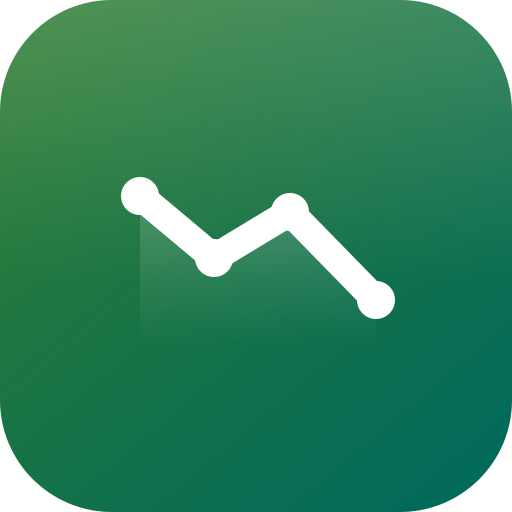
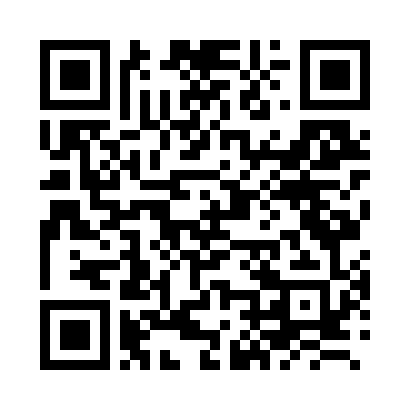

# SlimTrack

<p align="center">
  
</p>

<p align="center">
  <a href="https://github.com/leissa/slimtrack/actions/workflows/ci.yml"></a>
  <a href="https://github.com/leissa/slimtrack/actions/workflows/release.yml"></a>
  <a href="https://github.com/leissa/slimtrack/releases"></a>
  <a href="https://leissa.github.io/slimtrack/fdroid/repo/"></a>
</p>

<p align="center">
  
  
  <a href="LICENSE"></a>
</p>

A small diet and weight diary for Android. Log meals per meal, track calories and macros
against daily goals, record weight and exercise, and see trends over time.

Everything is stored in a local Room database. Only food search and barcode lookup go
online, and they send nothing but the search term or the scanned barcode. Android Auto
Backup and device-to-device transfer are disabled, so the diary never leaves the device
(see `backup_rules.xml` / `data_extraction_rules.xml`).

## Features

- Daily diary with four meals, calories and macros, exercise that raises the day's budget
- Weight entries with BMI, target weight/BMI and a chart showing every point plus 3-day and
  7-day averages, in metric or imperial units
- Diet tiers (fast / medium / slow) and a goal recommendation based on BMR and activity
- Food search across three sources:
  - **BLS 4.0** — 7,140 German foods, bundled offline
  - **FDDB** — German branded and user-entered products
  - **Open Food Facts** — international branded products and barcode lookup
- Barcode scanning with CameraX and ML Kit

## Install

<p>
  
</p>

Scan this QR code with F-Droid (**Settings → Repositories → + → scan**), or add the
repository address manually:

```text
https://leissa.github.io/slimtrack/fdroid/repo
```

Then refresh the repository list and install or update SlimTrack. The same APK is attached
to each GitHub release for manual installation.

## Stack

- Kotlin 2.2 + Jetpack Compose (Material 3)
- Room 2.8 (KSP) for persistence
- Lifecycle ViewModel + StateFlow, manual dependency container
- CameraX 1.6 + ML Kit barcode scanning
- AGP 9.5 / Gradle 9.6 · minSdk 26 · targetSdk 37

## Build and run

```bash
./gradlew :app:assembleDebug    # build the APK
./gradlew :app:installDebug     # install on the connected device/emulator
adb shell am start -n com.leissa.slimtrack/.MainActivity
```

Or open the project folder in Android Studio and press Run.

Start the emulator without Android Studio:

```bash
~/Android/Sdk/emulator/emulator -avd <your-avd>
```

## Tests, lint and continuous integration

```bash
./gradlew :app:testDebugUnitTest   # JVM unit tests
./gradlew :app:lintDebug           # Android lint
./gradlew :app:assembleDebug       # debug APK
./gradlew :app:assembleRelease     # release APK
```

`.github/workflows/ci.yml` runs unit tests, lint, and the debug and release builds on
every push to the default branch, every pull request, and on manual dispatch. Failed runs
upload the test and lint reports; successful runs keep the debug APK as a workflow
artifact for 14 days.

## Project layout

```
app/src/main/java/com/leissa/slimtrack/
├── SlimTrackApp.kt          Application, owns AppContainer
├── MainActivity.kt
├── data/                    Room entities, DAOs, database, seed foods, BLS table
│   └── remote/              FDDB and Open Food Facts clients
├── ui/
│   ├── SlimTrackRoot.kt     bottom navigation
│   ├── today/               daily diary, add-food sheet, exercise sheet
│   ├── history/             per-day totals and net calories
│   ├── weight/              weight entries, chart and targets
│   ├── scan/                barcode scanner dialog
│   ├── settings/            profile, goals and diet tiers
│   └── components/          shared progress bars
└── util/                    units, dates and number formatting
tools/extract_bls.py         regenerates the bundled BLS table from the official workbook
tools/release.sh             bumps the version, commits, tags and pushes a release
.github/workflows/           CI and release automation
docs/                        logo and README images, including the F-Droid repository QR code
fdroid/metadata/             F-Droid app metadata
```

Room schema exports land in `app/schemas/` — keep them in version control so future
schema changes can be migrated safely.

## Data model

- `Food` — name, serving label ("100 g", "1 medium"), calories and macros per serving.
- `DiaryEntry` — date (epoch day), meal, food reference, number of servings.
- `Goals` — single row with daily calorie/protein/carb/fat targets.
- `Profile` — units, sex, age, height, activity level, diet tier and target weight.
- `WeightEntry` — one per day (epoch day, kg).
- `ExerciseEntry` — date, activity, minutes and the calories burned at logging time.

The first launch seeds a starter food list (`data/SeedFoods.kt`).

## Food data

`app/src/main/assets/bls_foods.tsv` contains name, kcal, protein, fat and carbs per 100 g
for 7,140 generic foods from the **Bundeslebensmittelschlüssel 4.0**. Zero-calorie foods
such as water and unsweetened tea are included. It is generated with:

```bash
python3 tools/extract_bls.py \
    /path/to/BLS_4_0_2025_DE/BLS_4_0_Daten_2025_DE.xlsx \
    app/src/main/assets/bls_foods.tsv
```

The official workbook is a free download from <https://blsdb.de> (CC BY 4.0).

FDDB has no public API. `FddbClient` reads the anonymous website search page and fetches
nutrition from a product page only when the user picks that result. Keep requests sparse.

Attribution shown in the app's Profile screen:

- Bundeslebensmittelschlüssel 4.0, © Max Rubner-Institut (2025), CC BY 4.0,
  DOI 10.25826/Data20251217-134202-0
- Open Food Facts, ODbL
- FDDB, <https://fddb.info>

## License

SlimTrack is released under the MIT License; see [LICENSE](LICENSE). The bundled
Bundeslebensmittelschlüssel data keeps its own CC BY 4.0 license and attribution.

## Ideas for later

- Edit the servings of an existing entry
- Copy a whole day's meals
- CSV export
- Search synonyms (e.g. "yogurt" → "Joghurt" in the BLS table)
